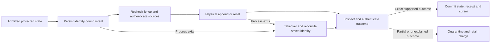

# Implemented technical disclosure and review handoff

16 October 2026. RCSD-PRISM-C research prototype. This document describes the supported embodiment for technical/filing review. It does not assert a novel invention, supply unknown human facts or authorize submission of an application. The [original proposal](RCSD_PRISM_C_Proposed_Invention_Disclosure.md) remains a historical design document; this disclosure follows the implemented scope.

## Identity and evidence status

| Item | Recorded fact |
|---|---|
| Human inventor(s), specific contributions | UNKNOWN, as instructed by the user |
| Applicant, ownership, assignments, addresses | UNKNOWN |
| Earlier application | User reports none; no identifier/date is invented |
| Earliest public disclosure and claim-specific supported priority | UNKNOWN; repository observed public on 12 October 2026 |
| Current invention decision | No distinguishing mechanism established against the capable conventional comparator |
| Subjective patent-readiness | 55/100; not grant probability |
| Current verified platform | Python/SQLite file authority and opt-in Linux/QEMU native-session authority; [exact builds and evidence](evidence/results/E21_EXECUTION.md) |

## Technical problem and existing approaches

Repairing an erasure-coded object consumes storage while old fragments and uncertain writes may still occupy capacity. A whole-zone storage abstraction additionally cannot recover space by deleting one interior fragment. Reclamation may need to relocate a live fragment before reset, while preserving enough independently placed code rows, references and source bytes to finish the admitted plan. Authority takeover must not turn an uncertain append into falsely free space or apply a stale reset to a reused incarnation.

Conventional planning, durable logs, capacity reservations, protection checks and acknowledged reset already address these classes of problem. The project implements and checks their interaction in a bounded prototype. Earlier hypotheses about certificates, selective suffix reuse, contingency alternatives and reset frontiers have not demonstrated a new capability beyond strengthened conventional controllers. See the [claim/source chart](evidence/results/CLAIM_REVIEW_2026_10_16.md) for the precise objection and published context.

## Components and data

The nominal state contains immutable object/coding identities; LIVE, STAGED and RETIRED extents; zone capacity and append position; zone phase/incarnation; fixed pins, external holds and reservations; offline domains; required reclamation; and open/active budgets. A finite action sequence covers reservations, code-row staging/adoption, retirement, zone close/finish and reset request/acknowledgement. The conventional joint planner searches this supported grammar and an independent reference checks bounded feasibility/work.

The opt-in persistent authority stores a versioned state, unique store identity, current owner fence, immutable manifests, one installed plan, cursor, pending intent, quarantine state and action receipts. Each manifest identifies coding profile, length, content epoch, content digest and every generated row digest. The supported profiles are systematic 2+1 XOR and 4+2 P/Q over GF(256), polynomial 0x11d. No plaintext recovery fallback is retained.

The file authority uses SQLite WAL and FULL synchronization and holds `BEGIN IMMEDIATE` throughout each byte read or physical-operation transaction. This serializes trusted local actors and retains sources while they are used. It does not implement distributed consensus or revocation of asynchronous device commands. One whole-scope immutable plan is admitted per fresh store; general dynamic cancellation and mutable object writes are outside this embodiment. The separate native variant adds the submitted-command barrier described below.

## File embodiment: operational method

1. Bootstrap a fresh store with validated, protected code rows and immutable row/content digests. Creation can leave an unusable root if interrupted; never reuse it silently.
2. On admission, check the witness initial fingerprint, every supported transition, physical geometry, protected final target and authenticated online LIVE content. Resource allocation is enforced through the authority, rather than assumed by a paper plan.
3. Before a physical stage/reset action, persist an intent bound to store/cursor/pre-state/action, zone identity/incarnation and expected position; stage additionally binds immutable source epoch and target row digest.
4. Re-enter the serialized I/O transaction and recheck the fence/intent. Authenticate required source rows and reconstruct the immutable object using a valid basis, checking supplied redundant rows, zero padding, regenerated row digests and content digest.
5. Append the intended code row at the expected physical position and synchronize. If an exact complete append already exists after a process interruption, authenticate and adopt it. A partial, extra or invalid append quarantines the store and retains its charge. Never truncate to undo an unexplained append.
6. Publish the action result, receipt, state and cursor together. Duplicate/stale callers cannot publish a second operation at the new incarnation.
7. Reclaim only when the supported reference/protection closure permits reset. The local file embodiment emulates whole-zone reset with truncation and synchronization. It releases capacity/tokens only after reconciling the prepared reset result and advancing incarnation in the authority.
8. Takeover increments the fence after waiting for existing serialized transactions. A previously prepared actor must reacquire the transaction and pass the new fence check before further I/O. This argument depends on the absence of already submitted asynchronous commands.

The implementation requests synchronization; it does not establish the durability characteristics of a physical disk/controller, directory creation, an arbitrary filesystem or power loss. The native variant implements the bounded continuous-session portion of the [device contract](spec/native_zoned_validation.md), including authoritative status and drain semantics; its exact enabled scope is the [native authority contract](spec/native_session_authority.md). Empty file length is meaningful only in the trusted, serialized file-emulation contract.

## Examples and measured limits

R15 checks 32 registered nominal cases: 12 feasible, 20 infeasible, zero disagreements with the independent oracle, and 280 exact RAM-prefix readbacks. Two staged/tight fixtures use one stage instead of two under a restricted GC-first schedule. The joint **conventional** controller obtains this saving; it is not attributed to a certificate.

E16 delivers 24 fresh file-backed route stores and 280 exact prefix reads, plus 32 actual process-exit outcomes: 28 resume and four conservatively quarantine as expected. These are process failures around explicit boundaries, not device power cuts. Full verified source at E18 has 213 methods/501 subtests, 10,000 traces and passing Ubuntu/Windows source CI. Later source changes require their own reports and cannot inherit these hashes.

E17 pilots preserve conventional parity, elapsed-time losses and insufficient sampling. E18's original characterization was interrupted after 64 saved windows; its [declared continuation](experiments/e18_continuation_protocol.md) completed all 120 windows/144000 reads while preserving the prefix and recording session confounding. Two of four repeatability screens fail. [E19](evidence/results/E19_EXECUTION.md) implements a compatible shared codec, independently verifies its bytes and collects fresh calibration/120 controller windows. Its large warm codec-batch elapsed saving comes with higher cold initialization, insufficient batch CPU-clock resolution and two failed controller repeatability screens. It is shared engineering and receives no inventive credit merely for being faster.

## Native-session best implemented method

**Later native engineering amendment, 16 October:** [E20](evidence/results/E20_EXECUTION.md) checks actual NVMe ZNS commands and eight nominal codeword routes. The new opt-in [native-session authority](spec/native_session_authority.md) implements identity-bound prepared operations and receipts with a private serial supervisor owning the emulated controller. Its takeover barrier drains prior submitted commands/observes completions and rejects late old-fence requests before device submission; database lock acquisition is not treated as native quiescence. Actor exit can recover only while the bound supervisor/controller session remains continuous. Session loss/recreation fails closed. [E21 execution](evidence/results/E21_EXECUTION.md) now records passing local and remote 84-case campaigns, each with 74 actor terminations, plus exact source/verification limits. The earlier serialized file method remains accurate for its own format. Neither this native implementation nor the shared E19 codec establishes a new inventive mechanism, physical power-loss persistence or independent external reproduction.

Bootstrap claims a fresh supervisor session for exactly one store UUID and binds session/controller/namespace/boot identities. Admission authenticates native LIVE rows and the finite witness. Open/close/finish/stage/reset acknowledgement first persist the exact identity-bound operation; stages use two aligned 2048-byte writes and flush before publication. Reopening a dead actor's authority reconciles the prepared old/intended native report and authenticates completed row bytes from retained native sources. Partial or unexplained outcomes quarantine and expose zero appendable credit. Takeover requests the next supervisor fence under the authority transaction, waits for prior command completions, then commits the database fence. Unique receipts make old-cursor retries idempotent. A missing/recreated session is refused; no backing-file or serial-only adoption is permitted.

## Review disposition

The [illustrative narrow method skeleton and limitation/source mapping](evidence/results/CLAIM_REVIEW_2026_10_16.md) provide the current claim-review starting point. The native extension supports the bounded emulated continuous-session contract above. Physical-device durability, session-recreation/power-loss recovery, adversarial/distributed operation, mutable-data and asynchronous native-worker promises remain unsupported. Do not add those promises to claims without enabling implementation and evidence.

Resolve a precise operational distinction and the strongest known combination objection before treating a patent-directed claim as supported. Complete claim-specific search/family review and human entitlement/disclosure records, and obtain appropriate professional filing review. Technical verification, a working prototype and a well-formatted disclosure do not themselves establish novelty/inventive step. No application is filed, no human inventor is inferred and no score increase is earned by this handoff document.
